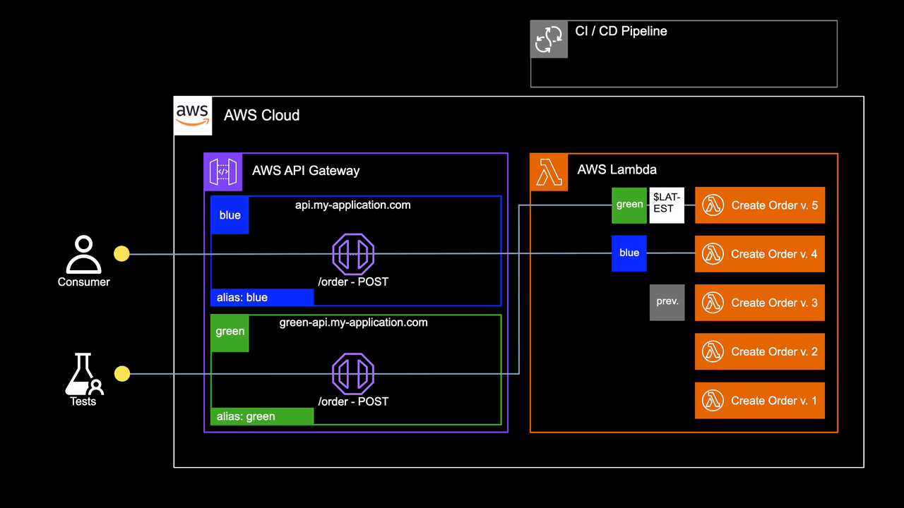

# AWS API Gateway + Lambda Blue/Green Deployment Reference Implementation

A reference implementation of a blue/green deployment strategy using **AWS API Gateway stages** and **Lambda function aliases**, built as a companion to a conference talk for [AWS Midwest Community Day 2026](https://www.midwestcommunityday.com).

See the recording at the [AWS Community Day Midwest YouTube channel](https://www.youtube.com/watch?v=GegInqiuccY&t=359s).

> [!IMPORTANT]
> **Update since the talk: the custom authorizer now uses blue/green too.** When I gave the talk, I believed that API Gateway Lambda authorizers couldn't use stage variables, and the documentation didn't make it clear either way. It turns out they can: an authorizer's URI can reference `${stageVariables.alias}` exactly like a Lambda integration's URI. The reference code, the authorizer pipeline, and this README have been updated so the authorizer follows the same blue/green strategy as the order Lambdas. See [The Custom Authorizer](#the-custom-authorizer) for the details and the gotchas.

## Overview

Blue/green deployment is a release strategy that reduces risk by running two identical production environments — **blue** (current) and **green** (new) — and shifting traffic between them only after the new version has been validated.

This project demonstrates how to implement that pattern on AWS using API Gateway and Lambda.

## Key Components

If you attended the talk, these are the steps that I walked through. If you didn't attend, these are the key components to understand how the blue/green deployment strategy is implemented in this project.

If you are updating an existing API Gateway + Lambda application that uses something like in-place deployments, follow these steps to implement the blue/green deployment strategy.

### API Gateway Stages

Your API Gateway may only have one stage today. With this approach, two API Gateway stages are needed, `blue` and `green`, each with a stage variable named `alias` that is the same as the stage name.

The API Gateway stages should have lifecycle rules configured to prevent automatic deployment on API changes, so that deployments are only triggered by the CI/CD pipeline after the new version is ready.

[api-gateway.tf](iac/api-gateway.tf) contains the API Gateway configuration, including the stage variables and lifecycle rules.

### Lambda Versioning

This is a simple opt-in (set `publish = true` on the Lambda function resource in Terraform) to enable versioning for each Lambda function. This allows us to create immutable versions of the Lambda functions that can be referenced by aliases.

[lambda-function/main.tf](iac/modules/lambda-function/main.tf) contains the Lambda function configuration, including versioning.

### Lambda Aliases

Three Lambda function aliases are needed with this approach: `blue`, `green`, and `previous`. The `blue` alias points to the currently live version, the `green` alias points to the latest deployed version for testing, and the `previous` alias points to the last live version before the current one.

`blue` and `previous` should have lifecycle rules configured to prevent being updated by Terraform, since they should only be updated by the CI/CD pipeline during promotion. `green` should be updated by Terraform during deployments.

> [!NOTE]
> The `previous` alias is optional, but it provides a quick rollback mechanism in case of issues with the new version.

[lambda-function/alias.tf](iac/modules/lambda-function/alias.tf) contains the Lambda alias configuration, including the `blue`, `green`, and `previous` aliases.

### API Gateway Integration

The API Gateway integration for each Lambda function should reference the `alias` stage variable in the Lambda function ARN, so that it dynamically invokes the correct version based on the stage.

For this demo, that invoke ARN has been added to the output of the Lambda function module, so that it can be easily referenced in the API Gateway integration configuration.

#### Lambda Permissions for API Gateway

The API Gateway needs permission to invoke the Lambda functions using the aliases. This is done by adding a permission resource for each alias.

> [!NOTE]
> Keep a permission for the `$LATEST` version. It doesn't do any harm, and prevents your API from temporarily breaking when first implementing this strategy.

[api-gateway-integration/gateway-integration.tf](iac/modules/api-gateway-integration/gateway-integration.tf) contains the API Gateway integration configuration, including the Lambda permissions for the aliases.

### The Custom Authorizer

The custom Lambda authorizer uses the same blue/green strategy as the order Lambdas, but it is deployed by its own independent pipeline and lives in its own Terraform project ([iac/authorizer/](iac/authorizer)).

An API Gateway authorizer is a REST API–level resource, not a stage-level one, which is why I originally assumed it couldn't take part in a stage-variable-based strategy. But the authorizer URI is resolved per stage at request time, so it can reference `${stageVariables.alias}` just like an integration URI does. The pieces are the same as for the order Lambdas:

- The authorizer Lambda function is versioned and has `blue`, `green`, and `previous` aliases ([iac/authorizer/authorizer-lambda.tf](iac/authorizer/authorizer-lambda.tf)).
- The `aws_api_gateway_authorizer` URI references the `alias` stage variable, so the `blue` stage invokes the authorizer's `blue` alias and the `green` stage invokes its `green` alias.
- API Gateway is granted permission to invoke the `blue` and `green` aliases (plus the unqualified function, for the same no-downtime reason as the integrations).

[api-gateway-authorizer.tf](iac/api-gateway-authorizer.tf) contains the authorizer configuration and its Lambda permissions.

Because the authorizer URI never changes between authorizer deploys, the authorizer pipeline doesn't need to deploy any API Gateway stages. Moving the authorizer's aliases is enough.

> [!IMPORTANT]
> On a fresh environment, run the [Deploy and Promote Authorizer](.github/workflows/deploy-authorizer.yml) workflow first with **initial-deploy** checked, then run the main pipeline. The main project's `terraform_remote_state` lookup requires the authorizer state to already exist, and its Lambda permissions require the authorizer's aliases to exist.

#### Gotchas When Using Blue/Green With Authorizers

**Deploy and promote the authorizer first.** If a change touches both the authorizer and the API Gateway integration functions, deploy and promote the authorizer before deploying the integration functions. The main pipeline only promotes the integration functions, so if they go first, the new integration code reaches `blue` while `blue` is still running the old authorizer. That means the new authorizer has to be backward compatible with the integration functions that are live on `blue` when it is promoted (an expand/contract approach: add what the new code needs, promote the authorizer, then ship the code that depends on it).

**A separately deployed authorizer can pass its tests and still break `blue`.** When the authorizer has its own pipeline (as it does in this repo), its tests on `green` exercise the new authorizer together with whatever the integration functions' `green` aliases and the `green` stage's API configuration point to, and that is not necessarily what is live on `blue`. For example, `green` might be missing an endpoint that `blue` still serves, or it might hold an un-promoted change from a failed main pipeline run. If the new authorizer removes or changes permissions that `blue` relies on, it can pass every test on `green`, get promoted, and break the live `blue` stage. The pipeline runs the test suite against `blue` after promotion, but by then live traffic is already affected, so make sure the test suite covers everything `blue` serves, and use the [rollback workflow](#rollback-lambda-aliasyml--rollback) (it supports the authorizer) if needed.

**Don't let the two pipelines overlap.** Both pipelines test against the `green` stage and promote to `blue`. If they run at the same time, one pipeline's tests can run against the other's in-flight changes. In this repo, both workflows share a GitHub Actions concurrency group (`ecommerce-blue-green`) so that only one runs at a time.

**Authorizer result caching delays promotion and rollback.** If `authorizer_result_ttl_in_seconds` is greater than zero, API Gateway caches the authorizer's policy per stage and identity source. After a promotion or a rollback, callers can keep getting the policy produced by the previous authorizer version until the cached entry expires. This repo uses a TTL of `0`, so it isn't affected, but if you enable caching, account for the TTL when testing after promotion and when rolling back.

**Each alias needs its own invoke permission.** API Gateway needs a Lambda permission for every alias it may invoke, with a `source_arn` that matches the authorizer (`.../authorizers/{authorizer_id}`), not the methods. A missing permission doesn't fail the deploy: requests through that stage fail with a 500 error (an authorizer configuration error) instead of a 401 or 403.

**Authorizer configuration changes go through the main pipeline.** Only the authorizer's Lambda code and configuration are promoted by moving aliases. Changes to the API Gateway authorizer resource itself, such as its identity source, type, or cache TTL, are API Gateway configuration, so they take effect on a stage only when that stage is deployed by the main pipeline (`green` first, then `blue`).

**Changes outside the Lambda version bypass blue/green.** A Lambda version captures the code and configuration, including environment variables, but not the execution role, or secrets and settings the authorizer reads at runtime (from Secrets Manager or Parameter Store, for example). Changing any of those affects `blue` and `green` immediately. In this repo, the API token is an environment variable, so a new token is versioned along with the code: `green` accepts the new token while `blue` keeps accepting the old one until promotion, and clients have to switch tokens at the moment of promotion.

**Don't hard-code the stage in the returned policy.** If the authorizer builds the `Resource` of its policy itself instead of using the incoming `methodArn`, make sure it doesn't assume a particular stage. A policy that only allows `.../blue/*` passes in one stage and fails in the other.

### CI/CD Pipeline

#### Deploying the Green Environment

The CI/CD pipeline should deploy the new version to the `green` environment first, and then run tests against it. If the tests fail, the pipeline should stop.

> [!NOTE]
> If you only have manual tests, add a manual approval step in the pipeline after deploying to `green`, and only proceed to testing and promotion after approval.

[build-deploy-and-promote.yml](.github/workflows/build-deploy-and-promote.yml) contains the GitHub Actions workflow for building, deploying, and promoting the new version.

#### Promoting to Blue

If the tests against `green` pass, the pipeline then:

1. Deploys the API gateway to the `blue` stage.
2. Updates the `blue` Lambda aliases to reference the versions referenced by `green`.
3. Updates the `previous` aliases to reference the versions that `blue` referenced before the update.

#### Cleaning Up Old Versions

After promotion, the pipeline should clean up any old Lambda versions that are no longer referenced by any aliases.

## Project Structure

| Path                                 | Description                                                                      |
|--------------------------------------|----------------------------------------------------------------------------------|
| `src/Ecommerce/`                     | .NET Lambda functions implementing a simple e-commerce orders API                |
| `test/Ecommerce.Api.Tests/`          | Integration test suite that validates the API end-to-end                         |
| `iac/`                               | Terraform infrastructure — API Gateway, Lambda functions, DynamoDB, ACM, Route53 |
| `iac/authorizer/`                    | Separate Terraform project for the custom authorizer Lambda (own state/pipeline) |
| `schemas/`                           | JSON schemas for API Gateway request/response validation                         |
| `postman/`                           | Postman collection and environments for manual testing                           |
| `.github/workflows/`                 | GitHub Actions CI/CD pipelines                                                   |

> [!IMPORTANT]
> If you are going to run this project yourself, make sure to update the input variables in [`iac/terraform.tfvars`](iac/terraform.tfvars), and the configuration values in [`iac/config.tf`](iac/config.tf) with values that are appropriate for your AWS account and environment.

## API

The API is a simple CRUD orders service with four Lambda functions:

- `POST /v1/order` — Create order
- `GET /v1/order/{customerId}/{orderId}` — Get order
- `PUT /v1/order` — Update order
- `DELETE /v1/order` — Delete order

All endpoints are protected by a custom Lambda authorizer. The authorizer uses blue/green too, but is deployed by its own pipeline. See [The Custom Authorizer](#the-custom-authorizer).

## CI/CD Pipelines

This project has three public-facing GitHub Actions workflows. The main pipeline and the authorizer pipeline share a concurrency group, so only one of them runs at a time. In a real-world application, you would want to break these into additional workflows for better separation of concerns.

> [!WARNING]
> The Build & Deploy GitHub action automatically deploys Terraform without any manual approval step. This is intentional for demonstration purposes, but in a production environment you should implement an approval step before deploying infrastructure changes.

### Key Concepts

- IAC updates green, not blue.
- Tests run against green before promotion.
- Promote green to blue only after tests pass.
- Promotion is a control-plane operation, not a data-plane operation.

### [build-deploy-and-promote.yml](.github/workflows/build-deploy-and-promote.yml) — Build, Deploy and Promote

1. Builds the infrastructure using Terraform — creates new Lambda versions (referenced by the `green` alias) and updates the API Gateway configuration.
2. Deploys the API Gateway `green` stage and waits 60 seconds for the deployment to propagate.
3. Runs the integration test suite against `green` — if any test fails, the pipeline stops here.
4. Deploys the API Gateway `blue` stage and waits 60 seconds for the deployment to propagate.
5. Promotes each Lambda function's aliases: `blue` → version `green` points to, `previous` → version `blue` pointed to.
6. Runs the integration test suite against `blue` to validate the promotion.
7. Cleans up unused Lambda versions.

### [rollback-lambda-alias.yml](.github/workflows/rollback-lambda-alias.yml) — Rollback

Updates the `blue` alias to point back to the version that `previous` points to, effectively rolling back to the last known good version. It works for the order Lambdas and the authorizer. (This workflow can also be used to rollback the `green` alias, in scenarios where we want to verify that the previous version of the API is still working as expected, before promoting it back to `blue`.)

### [deploy-authorizer.yml](.github/workflows/deploy-authorizer.yml) — Deploy and Promote Authorizer

Deploys and promotes **only** the custom Lambda authorizer from its separate Terraform project ([iac/authorizer/](iac/authorizer)). It uses its own Terraform state (S3 key `ecommerce-authorizer`), independent of the main infrastructure.

1. Builds the authorizer Lambda and applies Terraform, which publishes a new version referenced by the authorizer's `green` alias. The `green` stage starts using it right away.
2. Runs the integration test suite against `green`. If any test fails, the pipeline stops here.
3. Promotes the authorizer's aliases: `blue` → the version `green` points to, `previous` → the version `blue` pointed to.
4. Runs the integration test suite against `blue` to validate the promotion.
5. Cleans up unused authorizer versions.

No API Gateway stages are deployed, because the authorizer URI doesn't change between authorizer deploys.

Run this workflow with **initial-deploy** checked on a fresh environment, before the main pipeline. In that mode it only applies Terraform, since there is no API to test yet. Run it normally whenever the authorizer Lambda changes, and before the main pipeline when a change touches both (see [Gotchas When Using Blue/Green With Authorizers](#gotchas-when-using-bluegreen-with-authorizers)).

#### Branches that Demonstrate Different Scenarios

#### [`main`](https://github.com/OsborneSupremacy/api-gateway-bluegreen-demo/tree/main)

The main branch with the reference implementation. Deploying this branch will follow the standard blue/green deployment process and will succeed.

#### [`breaking-change-lambda`](https://github.com/OsborneSupremacy/api-gateway-bluegreen-demo/tree/breaking-change-lambda)

Simulates a breaking change in a Lambda function, causing the integration tests to fail. Deploying this branch will demonstrate the pipeline stopping at the test failure step, preventing promotion of a faulty version.

#### [`breaking-change-api-gateway`](https://github.com/OsborneSupremacy/api-gateway-bluegreen-demo/tree/breaking-change-api-gateway)

Simulates a breaking change in the API Gateway configuration, causing the integration tests to fail. Deploying this branch will demonstrate the pipeline stopping at the test failure step, preventing promotion of a faulty version.

## Notes

- The Lambda functions in this project are written in .NET, but the concepts are applicable to any language supported by Lambda.

- [test/Ecommerce.Api.Tests](test/Ecommerce.Api.Tests) is a regular .NET unit test project. This represents _any_ test suite that exercises and validates the functionality of the API.
    - I kept it the same framework as the API project for simplicity.
    - The test project deliberately is in a different solution than the API project and has its own copies of the request/response models and JSON schemas to ensure the tests are independent of the API implementation.

- [The custom authorizer Lambda function](src/Ecommerce/Ecommerce.Authorizer) is a naive implementation of an API Gateway custom authorizer.
    - It is not intended for production use.
    - It is included because this API Gateway is exposed to the public internet, and the authorizer offers some protection against unauthorized access.
    - It is deployed by its own pipeline and lives in a separate Terraform project ([iac/authorizer/](iac/authorizer)), but uses the same stage-variable-based blue/green strategy as the order Lambdas.

## Q&A

### There's nothing novel about this approach. Why is a reference implementation useful?

Teams probably know that a blue/green deployment strategy is possible with API Gateway and Lambda. But like most new patterns, someone (not in the absolute sense -- someone on a team or within an organization) has to be the first to implement it and share the details. Without someone doing that, a theoretical good idea may not be adopted for a long time, if ever.

In addition, in-place upgrades generally work well with API Gateway and Lambda. They are simple, and it's most likely rare that a change that passes testing in lower environments will fail in production. That can contribute to inertia and a lack of adoption of this approach.

### Is this strategy needed if I have one or more lower environments before production?

Even when changes are tested in lower environments, there is still risk when deploying to production. The power of this approach is to be able to deploy to production and test before affecting live traffic, with production release being a low-risk, control plane operation.

### Is this strategy needed if my API Gateway uses versioning, e.g. leave `/v1/order` as it is and create `/v2/order` for new changes?

If you never update existing API Gateway Lambda integration functions, always deploying new versions to new API Gateway resources, then you woudn't need this approach.

However, that would mean that you never update existing Lambda functions -- no new features, bug fixes, security patches, etc.. You would have to create a new Lambda function and a new API Gateway resource for every change, notifying consumers to update to the new API endpoint, and then deprecating the old one.

### Is this strategy needed if I use feature flags in my Lambda functions?

With feature flags, code that's behind a feature flag is not invoked until the flag is enabled. Once it's enabled, all traffic to that Lambda function is hitting the new code, and if there are any issues with it, then all traffic is affected. Given that, feature flags _alone_ do not provide the same level of risk mitigation as a blue/green deployment strategy like this one.

### What about API Gateway canaries and Lambda weighted aliases?

Those features are generally more sophisticated than the blue/green approach demonstrated here. They can be used for more granular traffic shifting, but they also add complexity.

If a team is not doing any kind of blue/green deployment strategy today, this reference implementation is a simple way to get started with the concept, and then they can iterate and add more sophistication over time if needed.

### Are the names `blue` and `green` necessary?

No, the aliases and stages can be named anything. I would recommend using names that are also names of environments, to avoid overloading those names. e.g. if you have a `uat` and `prod` environment, do not name your API Gateway stages `uat` and `prod`.

I like `blue` and `green` because they rarely conflict with environment names, and within the AWS ecosystem, AWS services that support native blue/green deployment strategies use those names (e.g. [ECS](https://docs.aws.amazon.com/AmazonECS/latest/developerguide/deployment-type-blue-green.html), [Aurora](https://docs.aws.amazon.com/AmazonRDS/latest/AuroraUserGuide/blue-green-deployments-creating.html), [Elastic Beanstalk](https://docs.aws.amazon.com/elasticbeanstalk/latest/dg/using-features.CNAMESwap.html)).

### Isn't testing in production impractical when it involves executing unsafe, destructive, expensive and/or irreversible operations?

This is an issue for any testing in production scenario, not just this blue/green deployment strategy. In order to be able to test in production _at all_, you need a solution for this.

How you deal with it depends on what your API does, and whether it is safe to execute those operations in a test context.

There are many factors that affect whether an organization can safely test in production.

Some APIs may not have to do anything special for test requests, allowing them to be run exactly as non-test requests. Maybe there's a downstream system that needs to exclude test consumers from billing, and that's the only special handling that needs to be done. In that case, the test requests can be treated the same as non-test requests.

Other APIs -- such as those that initiate building demolition sequences -- obviously cannot treat test requests the same as non-test requests. For these APIs, you need to implement a mechanism to safely test in production, such as a dry run mode, a test flag that is passed in the request, or a configuration setting of API consumers that identifies that as test consumer.

Testing in production is a complex topic, and I cannot cover all the scenarios here. The important thing is to recognize that testing in production is a risk, and to implement a strategy for mitigating that risk.

> [!NOTE]
> If you currently don't have a safe way to test in production, take the time to figure out a solution before implementing this blue/green deployment strategy.
